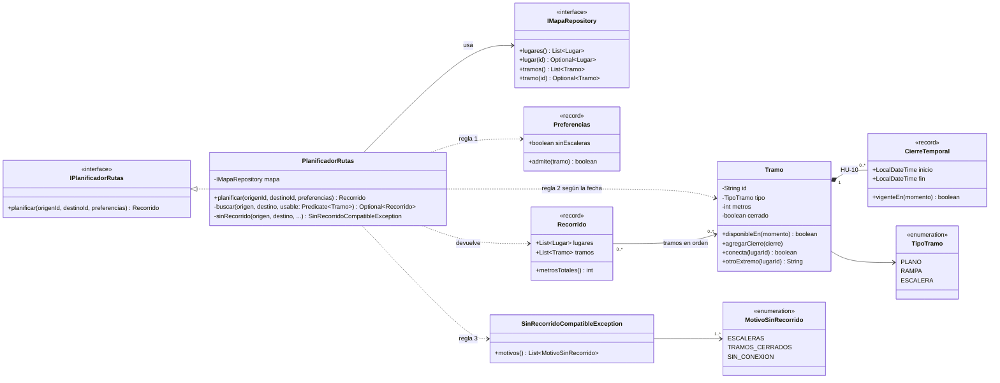

# C4 nivel 4 · Vista de código del planificador

Esta vista muestra solo la parte crítica del sistema: cómo `PlanificadorRutas` aplica las tres reglas del enunciado. El resto del código no se dibuja a este nivel, porque el diagrama de componentes (nivel 3, en [workspace.dsl](workspace.dsl)) ya alcanza para entenderlo.

## Dónde vive cada regla

| Regla del enunciado | Clase y método | Prueba que la protege |
|---|---|---|
| 1 · «Sin escaleras» excluye esos tramos | `Preferencias.admite(tramo)` | `PlanificadorRutasTest.sinEscalerasExcluyeEscaleras` |
| 2 · Un tramo cerrado no se recomienda (con HU-10, también durante un cierre temporal) | `Tramo.disponibleEn(momento)` + `CierreTemporal.vigenteEn` | `PlanificadorRutasTest.tramoCerradoNoSeRecomienda` |
| 3 · Si no hay ruta compatible se informa | `PlanificadorRutas.sinRecorrido(...)` | `PlanificadorRutasTest.sinRutaPorEscaleras` |

## Multiplicidad Recorrido–Tramo

Un recorrido usa cero o más tramos, en orden. Un mismo tramo del mapa puede aparecer en muchos recorridos o en ninguno, y no le pertenece a un recorrido. Por eso es una asociación `0..*` a `0..*` y no una agregación «1 a muchos». Lo corrigió Ángel en la revisión del PR #16.

## Decisión de diseño

Las reglas 1 y 2 empezaron como dos `if` dentro de la búsqueda (commits `verde` de HU-03 y HU-04). En la refactorización se movieron al dominio y la búsqueda pasó a recibir un `Predicate<Tramo>`. Así, para explicar por qué no hay ruta (regla 3), basta con repetir la búsqueda relajando una condición a la vez, sin duplicar el algoritmo.
